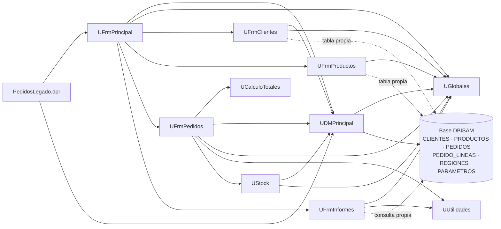

# Dependencias de Pedidos Legado (respaldo)

> Respaldo de la etapa 1 de la Unidad 4. Una flecha `A --> B` significa «A usa a B» (cláusula `uses`). Las flechas punteadas son accesos directos a la base desde un formulario, con su propio componente DBISAM.

## Lectura rápida

- **`UGlobales` es la más usada:** la usan casi todas las unidades. Un cambio ahí afecta a todo el sistema.
- **`UCalculoTotales` no depende de pantallas ni de la base de datos** (solo de `SysUtils`). Es la candidata natural para migrar primero, porque se puede probar sola.
- **Tres formularios llegan a la base sin pasar por `UDMPrincipal`:** `UFrmClientes`, `UFrmProductos` y `UFrmInformes` tienen sus propios componentes DBISAM.
- **`UFrmPedidos` concentra dependencias:** usa cálculo, datos, globales, utilidades y stock.
